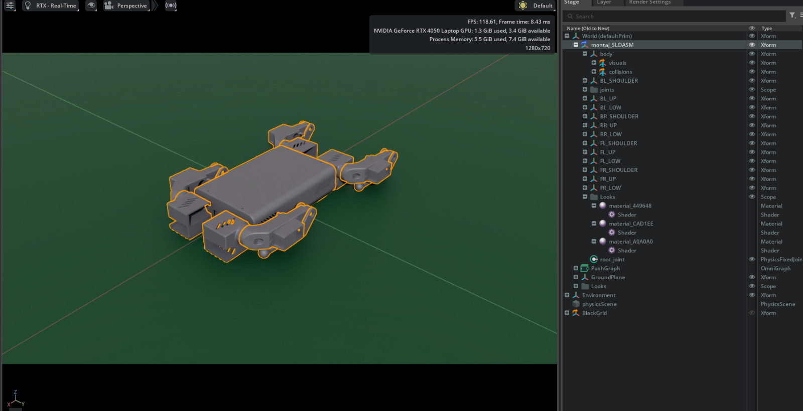

# KOUDRUPED in NVIDIA Isaac Lab

  

<i>KOUDRUPED imported into NVIDIA Isaac Sim.</i>

This repository brings the **KOUDRUPED** 12-DOF quadruped into **NVIDIA Isaac Sim / Isaac Lab** as the base for **reinforcement-learning-based locomotion**. The goal is to train a walking policy in simulation and later transfer it to the physical robot.

Robot model and Simulink work: [koudruped-control](https://github.com/Eemirhan/koudruped-control)

## Roadmap

- [x] Export the robot as URDF
- [x] Import the URDF into Isaac Lab
- [x] Correct joint frames, axes and angle conventions so the simulated robot matches the physical one
- [ ] Define the locomotion task (observations, actions, rewards)
- [ ] Train a flat-terrain walking policy (PPO)
- [ ] Rough terrain and domain randomisation
- [ ] Sim-to-real tests on the physical robot

## Robot structure

The robot has a `body` link and three links per leg, connected by 12 revolute joints:

| Leg | Shoulder | Upper leg | Lower leg |
|---|---|---|---|
| Front left | `FL_SHOULDER` | `FL_UP` | `FL_LOW` |
| Front right | `FR_SHOULDER` | `FR_UP` | `FR_LOW` |
| Back left | `BL_SHOULDER` | `BL_UP` | `BL_LOW` |
| Back right | `BR_SHOULDER` | `BR_UP` | `BR_LOW` |

## Asset preparation

After importing the URDF, several joints did not match the real robot: some had flipped axes, some had zero positions that differed from the physical calibration, and joint limits had to be set. I corrected these so that the same joint command gives the same leg pose in simulation and on the robot.

## Repository structure

| Folder | Content |
|---|---|
| `media/` | Screenshots |

## Requirements

NVIDIA Isaac Sim 5.1 and Isaac Lab, with an NVIDIA RTX GPU.
